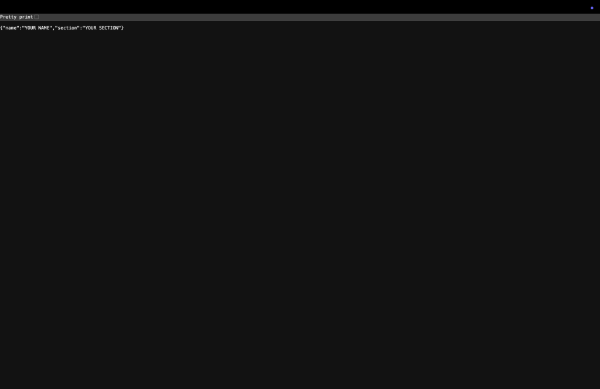

# Lab 1: Node.js and Express server

**Name:** ch.venu · **Registration number:** 252U1R9023 · **Section:** CSE-GEN-AI-2A-304

**Live link:** Not deployed (running locally on http://localhost:3000, browser screenshots added below)

## How to run

```bash
cd "Lab 1"
npm install          # installs express into node_modules
npm start            # Express server on http://localhost:3000
npm run start:http   # (optional) plain http version of the server
```

Environment variables: none required. `PORT` is optional (defaults to 3000).

## Files

| File | Purpose |
| --- | --- |
| `server-http.js` | Plain server using the built-in `http.createServer`, replies "Hello" |
| `server.js` | Same server rewritten with Express, with routes and a 404 handler |
| `package.json` | Project metadata, scripts and dependencies |
| `.gitignore` | Keeps `node_modules/` and `.env` out of Git |

## Endpoints

| Method | Path | Description | Status |
| --- | --- | --- | --- |
| GET | `/` | Welcome text | 200 |
| GET | `/about` | JSON with name and section | 200 |
| GET | `/time` | Current date and time from `new Date()` | 200 |
| GET | any other path | "404 Not Found" message | 404 |

## package.json fields explained

| Field | Meaning |
| --- | --- |
| `name` | Package name (lowercase, no spaces) |
| `version` | Current version, in major.minor.patch format |
| `description` | One-line summary of the project |
| `main` | Entry file of the project |
| `scripts` | Shortcut commands run with `npm run <name>` (`npm start` for `start`) |
| `keywords` | Search terms for the npm registry |
| `author` | Who wrote it |
| `license` | Licence the code is shared under |
| `dependencies` | Packages needed to run the app (here: express). Added by `npm install express` |

## Status codes observed in the browser

| URL | Status code returned |
| --- | --- |
| `http://localhost:3000/` | 200 |
| `http://localhost:3000/about` | 200 |
| `http://localhost:3000/time` | 200 |
| `http://localhost:3000/anything-else` | 404 |

## Screenshots

### 1. Home route (`/`)


### 2. About route (`/about`)


### 3. Time route (`/time`)


### 4. 404 Route (`/anything-else`)


## Viva notes

- **package.json vs node_modules:** `package.json` is a small file describing the project and listing its dependencies. `node_modules` is the folder where the actual downloaded packages are stored. It can be rebuilt any time with `npm install`, so it is not committed.
- **What `app.listen` does:** it starts the server and makes it wait for incoming requests on the given port.
- **Request and response:** `req` holds what the client sent (URL, method, headers). `res` is what the server uses to send an answer back (status code, headers, body).

## Notes: problems faced and how I solved them

- Add your own notes here.
